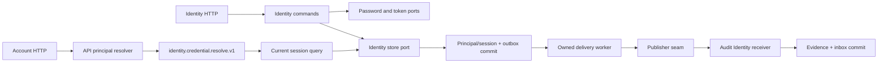

# Identity/session construction map

Implemented 2026-10-13 behind application/security/storage ports. Read
[behavior](../../contracts/behavior/identity-sessions.md),
[HTTP](../../contracts/http/identity-sessions-v1.md) and
[learning order](../../backend/go/notes/README.md).

Identity owns no Account data. Real access credentials resolve a principal;
Account retains its owner authorization. Audit records principal-scoped facts
without inventing account IDs. Its old Account fingerprint shape remains stable.

Module roots choose memory/PostgreSQL stores and security adapters; commands/
queries never import concrete adapters. API credential resolution goes through
the versioned capability. The process declares/selects that provider, validates
configuration and starts workers only after assembly. One store owns one worker;
all workers stop before any module resources close.

The acceptance suite observes two-user HTTP scope, concurrent refresh reuse,
atomic rollback, expiry, leases, API crash/restore and durable revocation/sign-out.
[Account bootstrap/selection](../../contracts/behavior/account-bootstrap.md) now
supplies owned scope separately. [Native Go adapters](go-native-session.md) now
compose that scope; remote data and independent extraction are the next boundaries.
This construction does not establish a full
production identity system, OAuth server or connected native starter.
